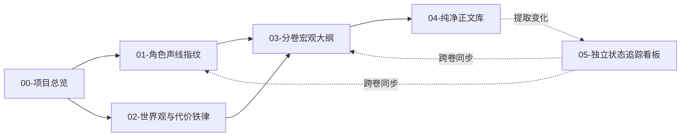

<p align="center">
  <a href="https://github.com/dashenbibi/novel-master">
    
  </a>
</p>

<h1 align="center">novel-master</h1>

<p align="center">
  <strong>面向中文长篇连载的 AI 创作 skill</strong>
</p>

<p align="center">
  <em>从设定、卷纲到章节续写，协助维护人物、伏笔和故事进度</em>
</p>

<p align="center">
  <a href="https://github.com/dashenbibi/novel-master">
    
  </a>
  <a href="https://github.com/dashenbibi/novel-master/blob/main/LICENSE">
    
  </a>
  <a href="https://github.com/dashenbibi/novel-master/releases">
    
  </a>
  <a href="https://github.com/dashenbibi/novel-master/issues">
    
  </a>
</p>

---

## 写长篇时，它能帮你做什么？

长篇创作常要同时照顾人物状态、前文细节、伏笔和文风。novel-master 把这些资料组织在本地项目中，供 AI 写作前查阅，并在写作后协助更新。

- **规划故事**：梳理题材、人物、世界观、卷纲和章节目标。
- **续写章节**：参考相关前文和当前状态，按你的要求写作。
- **检查与润色**：查找人物、时间线和设定中的疑点，检查重复表达、场景节奏和文风。
- **追踪变化**：分开维护正文和角色、道具、伏笔记录，方便后续查阅。

> 生成效果受模型、上下文和项目资料影响。建议作者检查正文及追踪更新，再决定是否发布。

---

## 📖 续写时，怎样接住前文？

以示范作品《九品仙奴》为例，第一章结束时，许良藏起断魂账上写有自己名字的一页，左臂受伤，正被崔道成盘问。

续写下一章时，你可以让 AI 先读取[上一章正文](examples/minimal-workspace/04-chapters/ch001.md)、[人物状态](examples/minimal-workspace/05-tracker/context.md)和[伏笔记录](examples/minimal-workspace/05-tracker/foreshadowing.md)，再根据你指定的方向写作：

```text
请用 novel-master 续写下一章。
先读取上一章、卷纲、相关人物状态和伏笔；承接崔道成的盘问。
写完后检查人物伤势和道具去向，并根据正文更新相关记录。
```

这里展示的是一种工作方式，不保证模型一定记住所有细节。写完后，作者可以重点检查伤势、账页去向和伏笔更新是否与正文一致。

---

## 🎯 核心功能



| 功能 | 作用 |
| :--- | :--- |
| ✍️ **章节写作与润色** | 按大纲和本书规则写作，检查套话、重复解释和视角衔接 |
| 🧭 **开篇规划** | 提供冲突、人物处境和前三章节奏的参考框架 |
| 📄 **正文与追踪分开** | 新项目可将章节正文与状态记录分别保存，便于阅读和维护 |
| 🧠 **人物与线索追踪** | 记录人物状态、能力边界、关键道具和伏笔，辅助后续续写 |
| ⚔️ **因果与一致性检查** | 检查人物动机、解决办法、世界规则和行动后果是否有依据 |

### 文风与规则的边界

当前 skill 默认偏向节奏紧凑、单场限制视角和具体场景描写；它对开篇节奏、正文中的解释性破折号和部分措辞有较严格的指导。这些默认值未必适合慢热、抒情或实验性作品。

你可以在本次请求或项目的 `rules.md` 中写明希望保留的叙事视角、语言风格、标点和节奏。skill 的优先级说明以用户明确要求和本书规则为先；如果输出仍不符合，请指出具体段落再调整。已有项目的正文格式和设定应优先沿用。

---

## 📸 示例工作区：《九品仙奴》

示范工作区位于 [examples/minimal-workspace/](examples/minimal-workspace/)：

### 1. 角色档案（可执行的声线指纹）

<details>
<summary>点击展开：许良（主角·代号丁七）档案切片</summary>

```markdown
# 许良

## 1. 基本信息
- **宗门代号**：丁七（白浮宗九品仙奴编制编号：南荒药字丁七）
- **修为境界**：表面炼气三层（隐匿一层，实为炼气四层初期）
- **外貌特征**：身形如狼般精瘦削长；脚踝有一圈被铁链磨出的深青色死皮；左眉豁开半截；常穿麻线粗缝的灰黑药奴囚坎肩，两手骨节突出，常年沾满草腥与泥浆。

## 2. 行为模式与声线纪律
- **面对霸凌与压迫**：极少口头争辩，习惯垂眼颔首，把身躯放低以避开锋芒，暗中观察对手腰间刀柄朝向、重心落点与换气节拍。
- **面对杀戮抉择**：出手快准狠，惯用割草镰断筋、石灰呛目、泥浆窒息等近身杀招，绝无任何心慈手软。
- **语气基调**：冷硬、短促、极平，字句如冰珠落地。
- **口头习惯**：“崔爷，草拔完了。” / “欠的三粒碎灵，下月补。” / “……明白。”
- **禁忌用语**：“放过我吧！” / “我和你拼了！”（生死交锋时绝不出声，全在手上动作）。
```

</details>

### 2. 章节正文示例

<details>
<summary>点击展开：第 1 章纯净正文切片</summary>

```markdown
# 第1章：雨夜暗账

## 正文

酉时刚过，天色就沉得像落了层锅底灰。
南荒十万大山的秋雨断断续续，顺着药棚发霉的草檐往下淌，打在泥地上泛起一股微酸的腐草气。
许良蹲在药垄深处，手里攥着一把磨去半截月牙的生铁割草镰。镰刀在泥地里轻巧地一挑，将缠在药苗根部的几株腐尸藓整齐割断，顺手扔进背后的竹篓。手背上的旧割痕被冷雨泡得发白，有些发痒，他没去管，只是习惯性地把呼吸放得很轻。

……

崔道成没说话，拖着那柄沉重的斩马刀走上田埂。
刀尖在湿石上划出刺耳的轻响。
他在许良身前三尺停住，居高临下地打量着这个浑身抖得像落水鸡仔的药奴，斩马刀缓缓挑起，冰凉沉重的刀脊直接贴上了许良颈侧的皮肉。
刀锋压得很稳，割破了一丝油皮。
崔道成那双布满血丝的死鱼眼微微眯起，盯着许良的眼睛，声音压得极沉：
「刚才掉下来的东西……你都瞧见什么了？」
```

</details>

### 3. 解耦状态看板（独立于 `05-tracker/context.md`）

<details>
<summary>点击展开：独立状态机看板切片</summary>

```markdown
# 上下文与即时状态追踪看板

## 角色即时状态机
- 许良（代号丁七）：炼气四层初期；暗中裁下断魂账中关于自己的死签藏匿于草鞋内，正面对崔道成斩马刀压喉的生死试探。
- 崔道成（黑刀崔）：炼气八层巅峰；从包德全尸身起获大半本断魂账，阔刀逼问许良口供，杀机待发。

## 关键道具流转
- 断魂账第七页死签：许良持有（藏于草鞋夹层）。
- 残缺断魂账主册：崔道成持有。
```

</details>

---

## 🚀 快速开始

安装 skill 后，可以先试写一个片段，或直接在已有小说项目中使用。

### 第一步：安装并调用

选择工具支持的 skill 目录，克隆整个仓库，保留 `SKILL.md`、参考资料和模板：

**Codex、OpenCode，以及使用默认状态目录的 OpenClaw：**

```bash
git clone https://github.com/dashenbibi/novel-master.git ~/.agents/skills/novel-master
```

**Claude Code：**

```bash
git clone https://github.com/dashenbibi/novel-master.git ~/.claude/skills/novel-master
```

其他支持 skill 目录的工具，请放入该工具文档指定的位置。安装后开启新会话，输入“使用 novel-master”；Claude Code 可输入 `/novel-master`，Codex 可在 `/skills` 中选择或使用 `$novel-master`，OpenCode 可提及 `@novel-master`。路径和加载方式可能随版本与配置变化，可查看 [Codex](https://developers.openai.com/codex/skills/)、[Claude Code](https://code.claude.com/docs/en/skills)、[OpenCode](https://opencode.ai/docs/skills/) 和 [OpenClaw](https://docs.openclaw.ai/tools/skills) 文档。

已有目录时无需再次克隆；进入实际安装目录，先用 `git status` 检查本地修改，再用 `git pull --ff-only` 更新。

### 第二步：选择使用方式

### 模式 A：试写一章


选择一个示例，按自己的题材、文风和篇幅修改后使用：

#### 选项 1：硬核悬疑 / 刑侦罪案
```text
请用 novel-master 帮我写一部现代硬核刑侦悬疑小说的第 1 章试读：
- 核心脑洞：暴雨夜旧城区拆迁废墟，停职三年的老刑警从一具被水泥浇筑的无名骸骨胸口，起获一枚刻着当年专案组编号的警徽
- 主角设定：右腿微跛的老刑警，戒烟嚼甘草片，眼神毒辣，少言寡语，习惯从微小物理痕迹反推凶手动作
- 核心冲突：现任支队专案组正驱车赶往现场，主角必须在 15 分钟内完成痕检并隐藏关键证物
- 语言纪律：减少重复解释与套话，按场景选择标点，单场限制主视点，3000 字左右纯净正文。
```

#### 选项 2：都市异能 / 赛博科幻
```text
请用 novel-master 帮我写一部赛博科幻生存小说的第 1 章试读：
- 核心脑洞：地下黑市义体维修工，在拆解一名被猎杀的仿生人间谍脑机芯片时，偶然解密出一份针对整座贫民窟的生化清洗令
- 主角设定：指尖嵌着焊锡烙印的年轻技工，冷静寡言，生存直觉极强，绝不冲动出头
- 核心冲突：负责灭口的公司清道夫无人机已经悬停在维修铺屋顶，红外扫描激光正切过铁皮门缝
- 语言纪律：减少解释腔，注重机械细节与场景氛围，3000 字左右纯净正文。
```

#### 选项 3：仙侠玄幻 / 凡人求生
```text
请用 novel-master 帮我写一部仙侠凡人求生流小说的第 1 章试读：
- 核心脑洞：南荒边陲恶宗里的一介下九品药奴，雨夜意外拾得执事断魂账，发现自己已被定为“下月初三开鼎剥髓的人药药引”
- 主角设定：表面木讷顺从，实则如狼般凶戾隐忍、动作极干净利落的药奴少年
- 核心冲突：巡山黑刀执事提刀踏入药棚逼问口供，刀脊已经压在主角颈侧
- 语言纪律：减少堆砌修饰，开篇注重自然白描与生活气息，3000 字左右纯净正文。
```

---

### 模式 B：创建长篇工作区

可以按需建立总览、角色、世界观、卷纲、正文和追踪文件。以下是一种工作方式：

#### 第一步：初始化项目工作区
```text
请用 novel-master 为我规划一部长篇小说《书名》：
- 题材：[填入你的题材，例如：现代刑侦悬疑 / 赛博科幻 / 凡人仙侠]
- 核心主线：[一句话核心脑洞与主要冲突]
- 架构要求：严格执行“正文纯净解耦”，将记忆清单与状态看板独立归档于 05-tracker/。
先生成 00-overview.md、rules.md 及标准目录骨架。
```

#### 第二步：沉淀专属文风与角色指纹
```text
请为主角和核心对手建立角色档案。
重点锁定两人的声线指纹、防御机制与口癖禁忌，确保对话交锋干净利落，拒绝千人一面。
```

#### 第三步：工业化章节生产与解耦追踪
```text
# 步骤 1：梳理黄金骨架
请为第 1 章生成大纲骨架，明确开场处境、核心对抗点、认知转折与章末悬念。

# 步骤 2：扩写纯净正文
根据骨架扩写 3000 字正文，遵循本书文风，减少重复解释与套话，末尾不带任何自检备注与元数据。

# 步骤 3：跨卷解耦同步
在 05-tracker/context.md 与 05-tracker/foreshadowing.md 中，同步更新本章的角色状态机、道具流转与伏笔记录。
```

### 已有作品：先整理，再续写

如果已经有章节和设定，可以指定现有目录，让 AI 先盘点材料，无需先重建项目：

```text
请使用 novel-master 查看我的小说项目：[项目目录]。
先列出已有的正文、大纲、角色和追踪资料，指出续写所需的缺失信息。
不要修改文件；我确认后再整理现有记录并续写下一章。
```

材料不完整时，可先处理有依据的部分；涉及关键事实不确定时请作者确认。整理和续写的效果取决于现有资料，长篇项目仍建议分批检查。

---

## 📚 项目目录结构

> 💡 **全题材通用提示**：仓库内置的 [examples/minimal-workspace/](examples/minimal-workspace/) 以冷峻铁血求生小说《九品仙奴》为示范案例；该目录结构可作为**悬疑刑侦、都市生活、科幻末世、历史架空、奇幻玄幻**等长篇作品的参考，具体文件和规则可按题材、作品及作者习惯调整。

```text
examples/minimal-workspace/
├── 00-overview.md          # 项目总览（题材、核心主线、三层卖点）
├── rules.md                # 本书规则（文风、用词与正文格式）
├── 01-characters/          # 角色档案库（声线指纹、行为模式、心理弱点）
│   ├── xu-liang.md         # 主角：下九品药奴丁七，少言寡语、动作凶戾
│   ├── cui-daocheng.md     # 宿敌：巡山堂黑刀执事，军汉悍卒，嗜杀多疑
│   └── wen-qiaoniang.md    # 盟友：百草谷辨药罪奴，外柔内刚，精于奇毒
├── 02-world/               # 世界观（九品仙奴制、活体剥髓律、南荒瘴气）
│   └── world.md
├── 03-volumes/             # 分卷大纲（全卷冲突、20章节奏全景表）
│   └── volume-01.md
├── 04-chapters/            # 章节正文（作者复核后使用）
│   └── ch001.md            # 第1章：雨夜暗账（纯净小说正文）
└── 05-tracker/             # 独立解耦追踪看板
    ├── context.md          # 即时上下文与角色状态机看板
    ├── capabilities.md     # 能力边界与战力追踪看板
    └── foreshadowing.md    # 伏笔埋设与回收状态全表
```

---

## 🗺️ Roadmap

- [x] **去 AI 味检查与写作规则**（说明性破折号、重复措辞、正文与追踪分开）
- [x] **开篇与前三章节奏指导**（处境、冲突和阶段推进）
- [x] **示范工作区**（《九品仙奴》第 1 章、设定与追踪文件）
- [ ] **多流派风格预设**（都市反套路打脸 / 规则怪谈 / 历史权谋谍战 / 赛博修真）
- [ ] **自动化冲突检测脚本**（利用 Python 与 LLM 联动扫描跨章节战力数值与伏笔断头）
- [ ] **番茄/起点一键排版导出工具**（自动化格式清理与章节导出）

---

## 🤝 贡献与反馈

欢迎在 [Issues](https://github.com/dashenbibi/novel-master/issues) 中分享你的使用体验、优质提示词改进方案，或提交 Pull Request。

如果你喜欢这个项目，请点亮右上角的 **Star ⭐**，让更多被“AI味”困扰的创作者找到真正好用的主笔伙伴！
