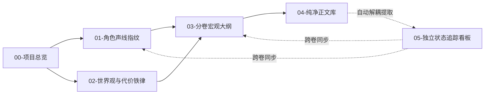

<p align="center">
  <a href="https://github.com/dashenbibi/novel-master">
    
  </a>
</p>

<h1 align="center">novel-master</h1>

<p align="center">
  <strong>面向中文长篇连载的工业级 AI 创作主笔协议</strong>
</p>

<p align="center">
  <em>告别翻译腔机味与 3 万字失忆崩塌 · 镜头感与黄金三章留存率拉满 · 交付开箱即发的成熟小说纯净正文</em>
</p>

<p align="center">
  <a href="https://github.com/dashenbibi/novel-master">
    
  </a>
  <a href="https://github.com/dashenbibi/novel-master/blob/main/LICENSE">
    
  </a>
  <a href="https://github.com/dashenbibi/novel-master/releases">
    
  </a>
  <a href="https://github.com/dashenbibi/novel-master/issues">
    
  </a>
</p>

---

## 💔 你是否也经历过普通 AI 写长篇小说的这 5 大绝望？

很多作者花几天构思了极其惊艳的大纲和人设，兴冲冲丢给 Claude、ChatGPT 或商业写作工具，结果往往令人抓狂崩溃：

1. 💥 **机味刺鼻，读者看两百字秒弃**：满屏的*“深吸了一口气”、“眼神中闪过一丝复杂”、“嘴角勾起一抹玩味的弧度”、“殊不知，命运的齿轮在这一刻悄然转动”*……千人一面的网课翻译腔，发到番茄、起点等平台，第一章书评区就被读者群嘲“一眼AI”直接点叉划走；
2. 💥 **连载 3 万字必失忆崩塌**：大模型上下文再大也无法自控长线逻辑。上一章打残的胳膊下一章提刀飞奔，死去的配角莫名复活，战力数值指数级通胀。作者花了 20% 的时间生成，却要花 80% 的时间给 AI 当“保洁阿姨”擦屁股修 bug，比自己手写还累；
3. 💥 **视角随地乱飘（Head-hopping）**：上一句还在写主角内心怎么算计，下一句突然跳进反派脑中窥探心声，再下一句以旁白视角剧透。角色的底牌全掀给读者，毫无博弈与拉扯，生死交锋变成了弱智过家家；
4. 💥 **开篇狂倒设定，黄金三章必死**：迟迟不进主线冲突，大段大段倾倒几千字世界观背景、修炼体系或社会制度，或者写主角睡醒刷牙的无机质流水账。在平台的商业签约审核与读者的生死留存线上直接暴毙；
5. 💥 **正文杂糅垃圾，无法一键发布**：每次生成都夹杂着*“好的，这是为您创作的第X章……”*、*“本章伏笔分析与后续建议……”*，正文和草稿混在一起，格式支离破碎，作者还要花时间肉眼清洗挑拣，根本无法直接复制发布。

> **AI 不是写不好长篇小说，而是普通的 AI 缺乏一套工业级的主笔约束协议！**
> 
> 大模型天生是“词语概率联想器”，它没有镜头意识、没有状态机、更不懂商业小说的读者心理学。  
> **novel-master** 不是普通的聊天提示词，而是为百万字职业长篇连载定制的**工业级主笔系统**：为 AI 注入白金作家的场景运镜准则与自闭环状态追踪机床，全题材通用，交付真正像真人写的成熟小说纯净正文。

---

## ⚡ 震撼对比：拒绝流水线用力过猛

无论你写**悬疑刑侦、科幻废土、都市商战、历史权谋还是修真仙侠**，普通 AI 总是充斥着舞台剧式的夸张假大空；而 **novel-master** 则以真实物理白描与生存智商推动剧情。

以一场经典的“底层求生与暗藏杀机”交锋戏为例，看看普通 AI 与 **novel-master** 的本质差距：

<table>
<tr>
<th width="50%">❌ 普通 AI 的套路化输出（用力过猛 / 舞台剧式假大空）</th>
<th width="50%">✅ novel-master 的工业级交付（真人笔感 / 真实呼吸 / 干净利落）</th>
</tr>
<tr>
<td>

暴雨是酉时三刻砸下来的。雷光撕裂了整座夜幕，大雨倾盆而下！

许良深吸了一口气，眼神中闪过一丝复杂而坚毅的神色。他看着眼前这本神秘的账册，心中暗自思忖：“没想到堂堂名门正派，背地里竟然做着如此伤天害理的勾当，连仙奴的性命都不放过！我许良绝不屈服于命运！”

就在这时，门外传来了一阵急促凶狠的脚步声。巡山执事崔道成带着一脸玩味的笑容走了进来，嘴角勾起一抹残忍的弧度，冷笑着说道：“许良，你这个小小的仙奴，今天休想活着离开这里！乖乖把账本交出来吧！”

许良毫无惧色，挺起胸膛，冷冷地看着他：“崔执事，多行不义必自毙，你们的阴谋迟早会被天下人知晓！”

整个药田的空气仿佛在这一瞬间彻底凝固了。

</td>
<td>

酉时刚过，天色就沉得像落了层锅底灰。南荒十万大山的秋雨断断续续，顺着药棚发霉的草檐往下淌，打在泥地上泛起一股微酸的腐草气。

许良蹲在药垄深处，手里攥着一把磨去半截月牙的生铁割草镰。镰刀在泥地里轻巧地一挑，将缠在药苗根部的几株腐尸藓整齐割断，顺手扔进背后的竹篓。手背上的旧割痕被冷雨泡得发白，有些发痒，他没去管，只是习惯性地把呼吸放得很轻。

碎石滑落，泥沟里跌下来一具后背带魔爪抓痕的尸首。是巡山哨所的管事包德全，怀中滚出一本兽皮册子。

许良用镰尖将册子钩到掌中，翻到第七页：「瘴云峰下九品药奴：丁七（许良）。自入宗起按例以蚀髓散拌入灵粥投喂三载，骨髓暗生玉胶。作价下品筑基丹三颗。交付期限：下月初三开鼎。取髓入药。」

难怪每月初一管事都会发下一包清甜的淬体散。原来养他们不是为了充实宗门，是在把活人当牲口催熟骨头。

远处犬吠与牛角号声逼近。许良眼神冷定，镰刃一抹削下自身那一页塞入破草鞋夹层，抓泥糊住尸体伤口，顺手扯过身旁荆棘在自己左臂拉开一道血痕，跌坐在垄旁装作惊恐药奴。

七尺斩马刀冰凉沉重的刀脊挑起，压在许良颈侧的皮肉上，割破了一丝油皮。崔道成死鱼眼微微眯起：

「刚才掉下来的东西……你都瞧见什么了？」

</td>
</tr>
</table>

### 🔍 为什么会有这种质的差距？

| 剖析维度 | ❌ 普通 AI 的通病 | ✅ novel-master 的工业级水准 |
| :--- | :--- | :--- |
| **视角与运镜** | 随意跳进主角与反派脑中窥探内心、自言自语，毫无悬念 | **单场限制视角**：镜头死锁在主角感官内，不窥心声，全凭动作与刀锋触感博弈 |
| **语言与动词** | 动词全拉满（“砸下来/撕裂/狠狠/彻底凝固/玩味弧度”） | **真实物理白描**：手背伤口发痒、熟铁环磨出的死皮、割草镰挑开暗账，文字像真人 |
| **智商与动机** | 底层药奴对着杀人狂大义凛然演正剧，反派脸谱化降智 | **人间清醒与底层狠劲**：数心跳、割死签、自残伪装、结巴求饶，生存智商极高 |
| **节奏与悬念** | 靠大段独白与感叹撑场，缺乏真实戏剧危机 | **黄金开头与即时危机**：300字登场、1000字爆出“下月初三开鼎剥髓”死签，命悬一线 |

---

## 🎯 核心杀手锏



| 特性 | 说明 | 带来的改变 |
| :--- | :--- | :--- |
| 🚫 **0 破折号与抗机味军规** | 严禁正文说明性“——”，铲除“砸下来/撕裂/狠狠/死死/彻底凝固”等膨胀动词 | 彻底摆脱浓厚的翻译腔与舞台剧表演感，叙事自然流畅 |
| ⚡ **黄金开头与黄金三章节拍** | 300字登场、1000字爆冲突，前三章完成“立身 $\to$ 筹码 $\to$ 首胜立誓”闭环 | 击碎传统AI的慢热开场与大段设定倾倒，大幅拉升首读留存率 |
| 🧭 **深度限制视角（场景运镜）** | 单场次镜头严格锁定主视点感官极限，严禁 Head-hopping 随地跳脑窥探心声 | 保留智斗悬念，放开开篇客观广角空镜、跨场次切镜与借道旁观者视角 |
| 📄 **纯净正文解耦架构** | `04-chapters/` 仅保留小说纯正文，绝无自检备注等开发垃圾 | 一键复制即可直接发布到番茄、起点等网文平台 |
| 🧠 **三维独立状态看板（05-tracker）** | 即时状态机（context）、能力战力边界（capabilities）、全书伏笔（foreshadowing）独立管理 | 支持 100 卷超长篇连载，战力与设定永不崩盘 |
| ⚔️ **反弱胜强因果防崩库** | 以“信息差洞察、机制克制、借势外部、代价闭环”四要素构成因果链 | 彻底杜绝后期无脑爆种锁血、临阵突破与强敌降智 |
| 🎭 **角色声线与心理博弈** | 严密锁定自称、句长习惯、防御机制与口癖禁忌，决断前进行深层利弊推演 | 告别千人一面与AI说教感，各色人物声线分明、双商在线 |
| ⚖️ **可验证规则与代价系统** | 每条世界观/社会/力量规则必须配套“限制、代价、破坏后果”，严防法则被轻率戏谑消解 | 告别纸老虎设定，全书力量体系与资源博弈因果严丝合缝 |

---

## 📸 真实效果展示（基于内置示范作品《九品仙奴》）

完整真实工程已内置于 [examples/minimal-workspace/](examples/minimal-workspace/)：

### 1. 角色档案（可执行的声线指纹）

<details>
<summary>点击展开：许良（主角·代号丁七）档案切片</summary>

```markdown
# 许良

## 1. 基本信息
- **宗门代号**：丁七（白浮宗九品仙奴编制编号：南荒药字丁七）
- **修为境界**：表面炼气三层（隐匿一层，实为炼气四层初期）
- **外貌特征**：身形如狼般精瘦削长；脚踝有一圈被铁链磨出的深青色死皮；左眉豁开半截；常穿麻线粗缝的灰黑药奴囚坎肩，两手骨节突出，常年沾满草腥与泥浆。

## 2. 行为模式与声线纪律
- **面对霸凌与压迫**：极少口头争辩，习惯垂眼颔首，把身躯放低以避开锋芒，暗中观察对手腰间刀柄朝向、重心落点与换气节拍。
- **面对杀戮抉择**：出手快准狠，惯用割草镰断筋、石灰呛目、泥浆窒息等近身杀招，绝无任何心慈手软。
- **语气基调**：冷硬、短促、极平，字句如冰珠落地。
- **口头习惯**：“崔爷，草拔完了。” / “欠的三粒碎灵，下月补。” / “……明白。”
- **禁忌用语**：“放过我吧！” / “我和你拼了！”（生死交锋时绝不出声，全在手上动作）。
```

</details>

### 2. 纯净正文实录（无任何杂质，即拷即发）

<details>
<summary>点击展开：第 1 章纯净正文切片</summary>

```markdown
# 第1章：雨夜暗账

## 正文

酉时刚过，天色就沉得像落了层锅底灰。
南荒十万大山的秋雨断断续续，顺着药棚发霉的草檐往下淌，打在泥地上泛起一股微酸的腐草气。
许良蹲在药垄深处，手里攥着一把磨去半截月牙的生铁割草镰。镰刀在泥地里轻巧地一挑，将缠在药苗根部的几株腐尸藓整齐割断，顺手扔进背后的竹篓。手背上的旧割痕被冷雨泡得发白，有些发痒，他没去管，只是习惯性地把呼吸放得很轻。

……

崔道成没说话，拖着那柄沉重的斩马刀走上田埂。
刀尖在湿石上划出刺耳的轻响。
他在许良身前三尺停住，居高临下地打量着这个浑身抖得像落水鸡仔的药奴，斩马刀缓缓挑起，冰凉沉重的刀脊直接贴上了许良颈侧的皮肉。
刀锋压得很稳，割破了一丝油皮。
崔道成那双布满血丝的死鱼眼微微眯起，盯着许良的眼睛，声音压得极沉：
「刚才掉下来的东西……你都瞧见什么了？」
```

</details>

### 3. 解耦状态看板（独立于 `05-tracker/context.md`）

<details>
<summary>点击展开：独立状态机看板切片</summary>

```markdown
# 上下文与即时状态追踪看板

## 角色即时状态机
- 许良（代号丁七）：炼气四层初期；暗中裁下断魂账中关于自己的死签藏匿于草鞋内，正面对崔道成斩马刀压喉的生死试探。
- 崔道成（黑刀崔）：炼气八层巅峰；从包德全尸身起获大半本断魂账，阔刀逼问许良口供，杀机待发。

## 关键道具流转
- 断魂账第七页死签：许良持有（藏于草鞋夹层）。
- 残缺断魂账主册：崔道成持有。
```

</details>

---

## 🚀 极速上手：双轨创作模式

无论你写**悬疑刑侦、科幻废土、都市商战、历史争霸还是修真仙侠**，只需直接调用指令，即刻体验真人作家级的成文质感：

### 模式 A：3 分钟灵感试读（适合快速尝鲜）

直接复制以下任意题材的 Prompt 喂给 AI，立即检验成文笔感：

#### 选项 1：硬核悬疑 / 刑侦罪案
```text
请用 novel-master 帮我写一部现代硬核刑侦悬疑小说的第 1 章试读：
- 核心脑洞：暴雨夜旧城区拆迁废墟，停职三年的老刑警从一具被水泥浇筑的无名骸骨胸口，起获一枚刻着当年专案组编号的警徽
- 主角设定：右腿微跛的老刑警，戒烟嚼甘草片，眼神毒辣，少言寡语，习惯从微小物理痕迹反推凶手动作
- 核心冲突：现任支队专案组正驱车赶往现场，主角必须在 15 分钟内完成痕检并隐藏关键证物
- 语言纪律：严格执行 0 破折号禁令，坚决不用“深吸一口气/眼神复杂/命运齿轮”等机味词，单场限制主视点，3000 字左右纯净正文。
```

#### 选项 2：都市异能 / 赛博科幻
```text
请用 novel-master 帮我写一部赛博科幻生存小说的第 1 章试读：
- 核心脑洞：地下黑市义体维修工，在拆解一名被猎杀的仿生人间谍脑机芯片时，偶然解密出一份针对整座贫民窟的生化清洗令
- 主角设定：指尖嵌着焊锡烙印的年轻技工，冷静寡言，生存直觉极强，绝不冲动出头
- 核心冲突：负责灭口的公司清道夫无人机已经悬停在维修铺屋顶，红外扫描激光正切过铁皮门缝
- 语言纪律：严格执行 0 破折号禁令，注重真实机械工业与冷雨白描，3000 字左右纯净正文。
```

#### 选项 3：仙侠玄幻 / 凡人求生
```text
请用 novel-master 帮我写一部仙侠凡人求生流小说的第 1 章试读：
- 核心脑洞：南荒边陲恶宗里的一介下九品药奴，雨夜意外拾得执事断魂账，发现自己已被定为“下月初三开鼎剥髓的人药药引”
- 主角设定：表面木讷顺从，实则如狼般凶戾隐忍、动作极干净利落的药奴少年
- 核心冲突：巡山黑刀执事提刀踏入药棚逼问口供，刀脊已经压在主角颈侧
- 语言纪律：严格执行 0 破折号禁令，坚决不用“砸下来/撕裂/狠狠”等膨胀动词，开篇注重自然白描与生活呼吸感，3000 字左右纯净正文。
```

---

### 模式 B：职业级全量工作区（适合长篇连载）

无论你创作的是任何品类的长篇小说，novel-master 的标准五层解耦工程骨架均可通用承载。以长篇连载流程为例：

#### 第一步：初始化项目工作区
```text
请用 novel-master 为我规划一部长篇小说《书名》：
- 题材：[填入你的题材，例如：现代刑侦悬疑 / 赛博科幻 / 凡人仙侠]
- 核心主线：[一句话核心脑洞与主要冲突]
- 架构要求：严格执行“正文纯净解耦”，将记忆清单与状态看板独立归档于 05-tracker/。
先生成 00-overview.md、rules.md 及标准目录骨架。
```

#### 第二步：沉淀专属文风与角色指纹
```text
请为主角和核心对手建立角色档案。
重点锁定两人的声线指纹、防御机制与口癖禁忌，确保对话交锋干净利落，拒绝千人一面。
```

#### 第三步：工业化章节生产与解耦追踪
```text
# 步骤 1：梳理黄金骨架
请为第 1 章生成大纲骨架，明确 300 字开场锚点、1000 字核心对抗点、认知转折与章末悬念。

# 步骤 2：扩写纯净正文
根据骨架扩写 3000 字正文，严守 0 破折号与抗机味军规，末尾不带任何自检备注与元数据。

# 步骤 3：跨卷解耦同步
在 05-tracker/context.md 与 05-tracker/foreshadowing.md 中，同步更新本章的角色状态机、道具流转与伏笔记录。
```

---

## 📚 项目目录结构

> 💡 **全题材通用提示**：仓库内置的 [examples/minimal-workspace/](examples/minimal-workspace/) 以冷峻铁血求生小说《九品仙奴》为示范案例；该目录结构完全适用于**悬疑刑侦、都市生活、科幻末世、历史架空、奇幻玄幻**等所有长篇小说品类，只需在对应文件中填充你所在题材的世界观与人物即可开箱使用。

```text
examples/minimal-workspace/
├── 00-overview.md          # 项目总览（题材、核心主线、三层卖点）
├── rules.md                # 创作军规（0破折号、抗机味禁词、纯净正文解耦原则）
├── 01-characters/          # 角色档案库（声线指纹、行为模式、心理弱点）
│   ├── xu-liang.md         # 主角：下九品药奴丁七，少言寡语、动作凶戾
│   ├── cui-daocheng.md     # 宿敌：巡山堂黑刀执事，军汉悍卒，嗜杀多疑
│   └── wen-qiaoniang.md    # 盟友：百草谷辨药罪奴，外柔内刚，精于奇毒
├── 02-world/               # 世界观（九品仙奴制、活体剥髓律、南荒瘴气）
│   └── world.md
├── 03-volumes/             # 分卷大纲（全卷冲突、20章节奏全景表）
│   └── volume-01.md
├── 04-chapters/            # 纯净正文库（即拷即发，无任何备注污染）
│   └── ch001.md            # 第1章：雨夜暗账（纯净小说正文）
└── 05-tracker/             # 独立解耦追踪看板
    ├── context.md          # 即时上下文与角色状态机看板
    ├── capabilities.md     # 能力边界与战力追踪看板
    └── foreshadowing.md    # 伏笔埋设与回收状态全表
```

---

## 🗺️ Roadmap

- [x] **工业级抗机味军规**（0 破折号、铲除“砸下来/撕裂”等膨胀动词、正文纯净解耦）
- [x] **黄金开头与黄金三章工业节拍**（300/1000 字节奏、三大基点与跨题材推进律）
- [x] **示范工作区全要素升级**（交付 3500 字纯净版《九品仙奴》第 1 章与全套三维状态看板）
- [ ] **多流派风格预设**（都市反套路打脸 / 规则怪谈 / 历史权谋谍战 / 赛博修真）
- [ ] **自动化冲突检测脚本**（利用 Python 与 LLM 联动扫描跨章节战力数值与伏笔断头）
- [ ] **番茄/起点一键排版导出工具**（自动化格式清理与章节导出）

---

## 🤝 贡献与反馈

欢迎在 [Issues](https://github.com/dashenbibi/novel-master/issues) 中分享你的使用体验、优质提示词改进方案，或提交 Pull Request。

如果你喜欢这个项目，请点亮右上角的 **Star ⭐**，让更多被“AI味”困扰的创作者找到真正好用的主笔伙伴！
